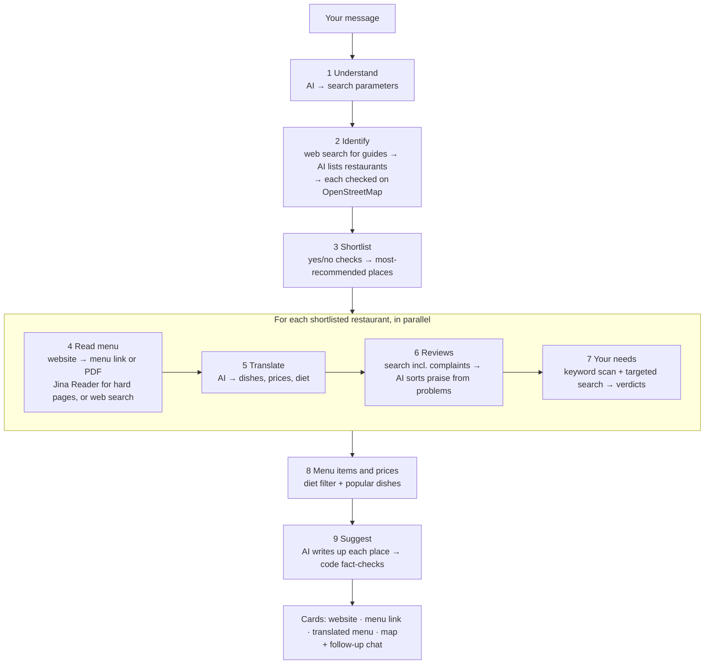

# 🍽️ Restaurant Scout

**An AI agent that finds somewhere good to eat in any European city, and shows exactly how it decided.**


Pick a **city** (40 in the list, or type any other European city), your **diet** (any, vegetarian, vegan, non-veg), the **meal** (breakfast, brunch, lunch, dinner) and a **budget bracket** shown in the city's own currency (e.g. *Mid-range · 15–30 €*, or *400–750 Kč* in Prague). Add anything else in one text box ("outdoor seating, quiet, gluten-free"). The agent then works through nine visible steps, and afterwards you can ask follow-up questions about the places it found in the chat box:

1. **Understands the request.** The AI turns your message into search parameters (city, meal, diet, other needs), including review keywords in the local language. Your **budget becomes numbers per person** in the local currency: "under €35" becomes *up to 35 €*, and words like "cheap" become an estimated range for that city, labelled as an estimate.
2. **Identifies restaurants.** It searches the web for food guides, reads them, lists the restaurants they recommend, and checks each one on OpenStreetMap.
3. **Shortlists.** Simple yes/no checks with no AI, each with a written reason. Of the places that pass, the ones recommended by the most food guides are **checked for closure news**, so a place that has shut down is skipped, and then looked at in depth.
4. **Reads the menu** from the restaurant's own website, finding the menu page or PDF in any language. The **Jina Reader** scraper steps in for menus built with JavaScript, PDFs, and sites that block simple readers.
5. **Translates the menu** from any language and script into English, or into the language you choose under *Options*, with prices and a diet label for each dish.
6. **Reads positive and negative reviews,** including a search aimed specifically at complaints.
7. **Searches for reviews about your needs** and gives each one a verdict: supported, contradicted, mixed or no evidence.
8. **Shows the regular menu items and prices** that fit your diet, starring dishes reviewers mention, and **works out the cost per person from the menu** (e.g. *17–23 € per person*) and compares it with your budget.
9. **Suggests where to eat.** Code fact-checks the AI's suggestions.

**Every suggestion includes:** the **cost per person in real money** with a budget check (within budget / partly / over budget), a **"How this was chosen"** section that walks through every step for that restaurant, the restaurant's **website link**, its **menu link**, the **full menu translated into English** with prices, what to order, and a **Google Maps** link. If the agent can't find the website or a readable menu, the button becomes a ready-made search for it, so a link is never missing.

**Where the data came from** is shown at the bottom of every search, in three tabs:
- **Diagram:** each free source and the step that used it.
- **Map of the restaurants:** your suggestions and the other places the guides mentioned.
- **Websites used:** every website the agent read, and what it read it for.

**Saved searches** are listed in the sidebar with a **Download** button, so you can keep a search or open it again later.

**Download as PDF.** Every finished search can be downloaded as a clean PDF with every website, menu and Google Maps link clickable, the translated menus, and a short "how this was put together" page. The **search history** in the sidebar lists every search with its own PDF button, plus **Download all as one PDF**, which adds a contents page.

Afterwards you can keep chatting ("which one is better for a quiet date?"), and it answers from what it found.

<!-- After your first search, add a screenshot: save it as docs/screenshot.png and uncomment the next line. -->
<!--  -->

## Completely free

| What | Service | Key |
|---|---|---|
| Main AI | [Google Gemini](https://aistudio.google.com/apikey) free tier (Gemini 3.8 Flash, falling back to lighter Gemini models) | Free, no credit card |
| Backup AI and backup web search | [Groq](https://console.groq.com/keys) free tier (`gpt-oss` models with built-in browser search) | Free, optional but recommended |
| Web search | DuckDuckGo through the [`ddgs`](https://pypi.org/project/ddgs/) package | None |
| Web scraping | [Jina Reader](https://jina.ai/reader) opens pages in a real browser and returns clean text | None (a free key makes it faster) |
| Restaurant facts | [OpenStreetMap](https://www.openstreetmap.org) through the Nominatim API | None |
| *Optional* open/closed check | [Google Maps Places API](https://developers.google.com/maps/documentation/places/web-service/text-search) (the "Permanently closed" label you see on Google Maps) | `GOOGLE_MAPS_API_KEY`; Google's free monthly allowance, but billing must be turned on |
| Hosting | [Streamlit Community Cloud](https://share.streamlit.io) | None |
| *Optional, paid* | [Claude API](https://platform.claude.com) (Claude Sonnet 5.5 / Haiku 5.5) as the main AI, pay-as-you-go | `ANTHROPIC_API_KEY`; not included in Claude Pro |


## How it works



### What each step does, and why

**1. Understand.** The AI must answer in a fixed JSON format (structured output), so the result is always usable. If no city is mentioned, the app asks for one instead of guessing.

**2. Identify.** Free sources have no star ratings, so popularity comes from **how many independent food guides recommend a place**. The agent runs three web searches, opens the top guide pages, and the AI lists every restaurant they recommend along with the numbers of the guides that mention it. Any guide number the AI invents is dropped. Each restaurant is then looked up on OpenStreetMap inside the city's boundary. This confirms the place exists and adds its address, website, cuisine, vegetarian/vegan tags and opening hours.

**3. Shortlist (no AI).**
- **Left out** only when the evidence clearly rules a place out: the map says it has no vegetarian food (for veg/vegan requests), its opening hours miss the meal, a guide rates it below 3.8 out of 5, or a guide quotes a price per person more than 25% above your budget.
- **Unknown facts don't count against a place.** They're marked "?" and checked later on the menu and in reviews.
- **Which ones are looked at in depth:** of the places that pass, the ones recommended by the most food guides. Ties go to places found on the map, then to places with a website, since their menu can be read. There are no points or scores.
- **Still open?** Guides and maps go out of date (for example, Rasoterra in Barcelona served its last meal in May 2026), so before a place is looked at in depth the agent checks, in this order (`scout/status.py`):
  1. **OpenStreetMap** tags such as `disused:amenity`.
  2. **Google Maps**, if a `GOOGLE_MAPS_API_KEY` is set: the same "Permanently closed" / "Temporarily closed" label people see on Google Maps. The result only counts if the name matches and it's within 600 m of the place, so a similarly named restaurant is never mistaken for it. When Google answers, that decides it.
  3. **The restaurant's own website**: a domain that no longer exists, a homepage that's been taken down (404/410), or a "domain for sale" page are strong signs it has closed, and the place is dropped. A farewell message on the site ("thank you for all these years", "último servicio") goes to the AI.
  4. **Three web searches**: "*name city* permanently closed", the same in the local language ("cierra", "fermé définitivement"…), and the place's review-site listing, because Tripadvisor and similar sites put "CLOSED" in the title of a closed restaurant.
  5. Only when something looks suspicious does the AI read those sources and decide whether *this* restaurant has closed, permanently or temporarily. Weekly closing days and similar names don't count.

  A closed place is skipped with its source shown, and the next one takes its place. **You always get open places:** if too few pass, places that only missed the guide-rating or guide-price check are considered, and if that's still not enough, more open places come from Google Maps (with a key) or OpenStreetMap. If the guide searches return nothing at all, broader searches are tried, then the same two backups. Each suggestion is labelled "✓ Open on Google Maps" or, without a Google key, "No closure found, check Maps before going". The review step is a second safety net: if reviews say a place has closed for good, it's left out.

- **Guardrails.** The app only helps with eating out in Europe. Before any search starts, the AI decides whether the message is actually a request for somewhere to eat or drink; anything else (general questions, coding, homework, attempts to change its instructions) gets a polite reply asking for a restaurant request, and nothing is searched. Messages are capped at 600 characters, follow-up questions are limited to the restaurants already found, and a city outside Europe is turned away.

**4. Read the full menu.** Restaurants publish menus in many ways (a page, several pages, a PDF, a scanned PDF, photos, a JavaScript page), so the agent tries them all, own website first, and keeps **every** page that is part of the menu (lunch, dinner, desserts), not just one (`scout/menu.py`):
- **The website's menu links**, found with the word for "menu" in many languages (*menu, menú, carta, carte, Speisekarte, menukaart, μενού…*) plus the local word for the city. A "Menus" page that only links to Lunch / Dinner / Desserts PDFs is followed one level down.
- **The site's `sitemap.xml`**, for menus hidden behind a JavaScript button, and the usual addresses (`/menu`, `/carta`, `/la-carta`, `/en/menu`, `/speisekarte`) when nothing links to the menu.
- **Every page is read directly first**, and with **Jina Reader** (a real browser) when the menu is built by JavaScript, is a PDF, or the site blocks simple readers.
- **Photo menus and scanned PDFs**: when the menu exists only as pictures, a vision AI (Gemini or Claude) writes out every dish and price.
- **Prices in every European style** count, including plain numbers at the end of a dish line ("Croquetas ..... 9", "Bravas 6,5").
- Only if the website has no menu does it search the web, and it uses only pages about **this** restaurant: its own site, or its page on a menu or booking site (TheFork, Tripadvisor, delivery apps…). "10 best restaurants" lists and other places are skipped, and each skip is shown. If nothing qualifies, it says so rather than guess.

The **Original menu** button opens the page the menu was read from. There are no Google-search links pretending to be menus.

**5. Translate.** The AI turns all of that text into the full menu, in parts so long menus aren't cut off: each dish with its section, original name, translated name, a short description, price (left empty when none is printed, never guessed) and a **cautious** diet label. The app and the PDF show it laid out like a printed menu, with V / VG marks and reviewers' favourites highlighted.

**6 and 7. Reviews.** These steps search for reviews, including one search aimed at complaints, since top results tend to be positive. The pages are read through the same scraper. The AI then sorts praise from complaints and checks each of your needs. **Every source link the AI gives is checked against the pages actually opened, and any invented one is removed.**

**8. Menu items, prices and cost per person (no AI).** The menu is filtered to your diet, and dishes that reviewers mention are starred. The cost per person is plain arithmetic:
- Take the priced food dishes on the menu, leaving drinks out.
- The middle half of those prices is a "typical dish". With prices of 7, 8.50, 9, 11.50 and 16 €, a typical dish is 8.50–11.50 €.
- A meal is about two dishes per person, so the estimate is **17–23 € per person**, before drinks.
- That is compared with your budget: **within budget**, **partly** (only if you pick the cheaper dishes) or **over budget**.
- If no menu prices were found but a guide quotes a price per person, that price is used instead, and the card says so.

**9. Suggest.** The AI writes a short, honest summary of each shortlisted place, covering why it fits, what to watch out for and what to order. It uses only the collected evidence, and it doesn't score or rank the places; they appear in the shortlist's order, most-recommended first. Code then checks the result: every write-up must be about a shortlisted place, and every recommended dish must appear on the translated menu. **Prices and the cost per person always come from the menu, never from the AI.**

**How this was chosen.** Every card has this section. It shows the food guides that recommended the place (with links), each shortlist check, the cost calculation, what reviews say about each of your needs, and how the write-up was checked.

### European cities only

The brief is restaurants for travellers in Europe, so the agent covers the 50-odd European countries (`scout/europe.py`). The city is checked twice, by the AI when it reads the request and by OpenStreetMap when it finds the city on the map. A city outside Europe gets a friendly message suggesting European ones.

Within Europe it adapts to each city:
- **Prices** are recognised in every local format (12,50 € · £14 · 45 kr · 120 zł · 390 Kč · CHF 28), and costs are shown in the local currency.
- **Menu pages** are found with the local word for "menu" (carta, carte, Speisekarte, menukaart, μενού, меню…); the AI also supplies it for each city.
- **Searches** are localised: DuckDuckGo is told the country, and one of the three guide searches is in the local language.
- **Closure news** is searched for in the local language too.
- **Budgets** are understood in the local currency. Words like "cheap" become a realistic range for that city.
- **Menus** are translated into English, or into the language you pick (Spanish, French, German, Italian, Greek and more).

### Design decisions

- **Why not a RAG database?** RAG (retrieval-augmented generation) means fetching relevant documents and giving them to the AI to answer from. The agent already does this live for every search: it retrieves fresh guide pages, menus and reviews, numbers them as sources, and makes the AI answer only from them with links back. A pre-built vector database of European restaurants would go stale (closures, new menus, prices), and there's no free, licensed dataset of European menus and reviews to fill it with. Live retrieval keeps every answer current and traceable.

- **A fixed pipeline instead of a free-roaming agent.** The goal is to *show* each step, so the steps are explicit, ordered and testable. The AI is used only where language or judgement is needed. Filtering, choosing which places to look at, link-finding, opening-hours checks and fact-checking are ordinary code.
- **The AI never supplies facts from memory.** Ratings, menus and prices come only from pages the agent actually opened, each with its source link.
- **Made for free plans:**
  - **Low "thinking".** Gemini 3 models think before answering by default; asking for low effort makes them much faster and stretches the free quota.
  - **Model fallbacks.** If a model times out or isn't available, the next one is tried (lighter Gemini models, then Groq), and the agent stays on whichever works. Groq's free plan allows only 8,000 tokens a minute, so long inputs are shortened for it.
  - **Rate limits.** Calls to each service are spaced out and retried on "too many requests".
- **Backups everywhere:** DuckDuckGo search falls back to Groq's search, and direct page downloads fall back to Jina Reader. The steps panel shows when a backup was used.
- **Check services.** A button in Settings (or `python check.py`) tests each service on its own, so a problem can be pinned to one service in seconds.
- **Safe and polite:** the app never opens private network addresses, calls OpenStreetMap at most once a second (their policy), and keeps going if one restaurant's site is down.

### Limitations and ideas

- Without a Google Maps key, the open/closed check relies on websites, review listings and news. A small place that closed quietly, with no news and a website still online, can slip through; the label tells the traveller to check Maps before going.
- Without paid APIs there are no live star ratings or review counts. Popularity comes from guide mentions and ratings that guides quote.
- OpenStreetMap data depends on volunteers, so some places lack opening hours or diet tags. These show as "unknown" rather than rejected.
- Opening hours are checked against typical meal times, not a specific date.
- "Near X" is judged from review and guide text. Using the map coordinates to measure distance would make it exact.

## Project layout

```
app.py            Streamlit app (search form, follow-up chat box; options and saved searches in the sidebar)
cli.py            same agent in the terminal
check.py          tests each free service on its own
scout/
  pipeline.py     runs the nine steps and streams progress
  understand.py   step 1
  discover.py     step 2: guides + OpenStreetMap
  shortlist.py    step 3 (no AI)
  menu.py         steps 4–5
  reviews.py      steps 6–8
  recommend.py    step 9, follow-up answers, fact-checking
  money.py        prices in real currency, cost per person, budget check
  links.py        website / menu / map links for every suggestion
  sources.py      "where the data came from": counts, diagram, websites table
  llm.py          AI client: model fallbacks, low thinking, rate limits, JSON output
  claude_adapter.py  optional Claude API, behind the same interface as Gemini and Groq
  pdf_report.py   PDF downloads: one search, or the whole search history
  status.py       "is it still open?" checks: map tags, Google Maps, website, closure news
  places.py       optional Google Maps (Places API) lookup
  europe.py       the European countries covered, and closure words by language
  fonts/          DejaVu Sans, so every European alphabet prints correctly in PDFs
  scrape.py       page reading: direct download + Jina Reader
  search.py       DuckDuckGo search + Groq backup search
  osm.py          OpenStreetMap lookups
  hours.py        opening-hours reader
  health.py       service checks
  web.py          safe downloads, HTML/PDF to text, menu-link scoring
  schemas.py      JSON formats the AI must follow
  models.py       data passed between steps
  config.py       settings, keys and free models
tests/            unit tests + full nine-step runs with fakes
```

## License

MIT
